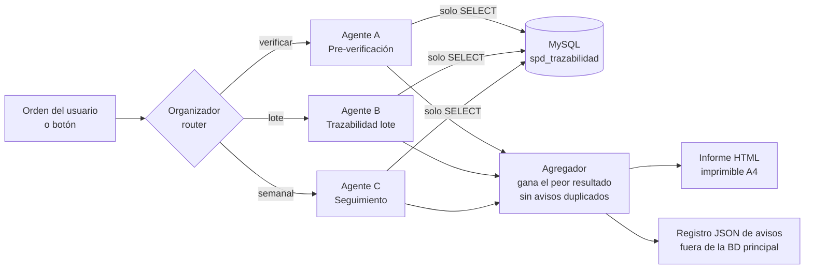

# Agentes de trazabilidad SPD · Apoyo a la decisión, en solo lectura, para un servicio de dosificación en farmacia

[English](README.md) · **Español**

> Agentes en SQL + Python que revisan los blísteres semanales de medicación de una farmacia **antes de que el farmacéutico los firme**, siguen cada dosis hasta su lote y generan una hoja semanal de tareas.
> **Nunca escriben en la base de datos ni deciden**: señalan, explican y priorizan. El farmacéutico decide y firma.

`MySQL` · `SQL` · `Python` · `pytest` · `Configuración YAML` · `Informes HTML` · `Calidad del dato` · `Diseño sanitario / RGPD`

---

## De dónde surge la idea

Soy técnico de farmacia en Madrid y estoy en transición hacia data analytics y BI. Este proyecto nace de un proceso real en el que participé: **la implantación del servicio SPD en mi farmacia**.

**SPD (Sistemas Personalizados de Dosificación)** es un servicio para pacientes polimedicados. Cada semana la farmacia saca los comprimidos de su envase original y los reacondiciona en un blíster con un alvéolo por día y toma (mañana, mediodía, noche). Lo regula el Procedimiento Normalizado de Trabajo (PNT) del Colegio Oficial de Farmacéuticos de Madrid (COFM, enero de 2023).

Hacerlo a mano y en papel me enseñó dónde están los riesgos:

- La validez del blíster **nunca puede superar la caducidad de ningún medicamento incluido**, y los medicamentos que caducan en menos de 28 días no son aptos.
- Cada dosis tiene que ser **trazable hasta su lote y caducidad**. Si se retira un lote, hay que saber *hoy* qué pacientes lo tienen en casa.
- Las recetas cambian, vencen y hay que renovarlas. Los pacientes olvidan devolver el blíster usado. Los alvéolos sin tomar son una señal de adherencia que se pierde fácilmente.

Son preguntas que una base de datos responde en segundos. Una persona cansada al final del turno puede pasarlas por alto. Por eso modelé el servicio en MySQL y estoy construyendo agentes pequeños que hacen esas preguntas de forma sistemática.

> Todos los datos de pacientes de este repositorio son **sintéticos**. Aun así, el diseño los trata como datos de salud reales (RGPD): datos mínimos en los informes y ningún dato personal enviado a servicios externos.

---

## Qué hacen los agentes

| Agente | Cuándo se lanza | Pregunta que responde | Salida |
|---|---|---|---|
| **A · Pre-verificación** | Antes de que el farmacéutico verifique un blíster | *¿Se puede firmar este blíster con seguridad?* | Semáforo por blíster + motivo por línea de medicamento |
| **B · Trazabilidad por lote** | Al llegar una alerta de retirada, o cada semana | *¿Qué pacientes tienen este lote y dónde está ahora?* | Afectados agrupados por estado + % de cobertura del dato |
| **C · Seguimiento semanal** | Al empezar la semana de preparación | *¿A quién hay que llamar, a quién renovar y a quién revisar?* | Una página imprimible con tres listas: **Llamar / Renovar / Revisar** |
| **Organizador** | `todo` / "Ejecutar todo" | Lanza A → B → C y une los resultados | Un único informe, lo más grave primero |

### Arquitectura



El organizador **no tiene lógica clínica**. Enruta la petición, reintenta una vez si un agente falla, ordena los resultados y evita repetir avisos que siguen abiertos. Si un agente falla, su sección dice **"Agente no disponible"**. Nunca dice "sin incidencias".

### Las decisiones, regla a regla

Cada regla es **una consulta SQL determinista** en su propio archivo `.sql` comentado. Cada resultado usa uno de cinco códigos:

`ROJO` (bloqueo) · `AMBAR` (revisar) · `NO_COMPROBABLE` (falta un dato) · `VERDE` (apto) · `LISTA` (lista de trabajo)

**Agente A: pre-verificación de un blíster**

| # | Comprobación | Si falla | Origen |
|---|---|---|---|
| A1 | El paciente tiene consentimiento, está de alta y no de baja en la fecha de preparación | ROJO | PNT p.5, anexo 2 |
| A2 | Todas las líneas tienen lote y caducidad | NO_COMPROBABLE | PNT p.11 |
| A3 | Ningún medicamento caduca antes de la validez del blíster | ROJO | PNT p.21 |
| A4 | Al menos 28 días entre preparación y caducidad | ÁMBAR | PNT p.19 |
| A5 | Validez ≤ 14 días | ÁMBAR (justificar por escrito) | PNT p.12 |
| A6 | Elaborador ≠ verificador | ROJO | PNT p.12 |
| A7 | Hay receta vigente de ese paciente y medicamento | ROJO | PNT p.21 |
| A8 | Posología del blíster = posología de la receta vigente | ÁMBAR | PNT p.19 |
| A9 | Ninguna forma no apta (inhalador, inyectable, parche…) dentro del blíster | ROJO | PNT p.8-9 |
| A10 | Ninguna incidencia sin resolver | ÁMBAR | PNT p.19 |

Un rojo → blíster en rojo. Solo ámbar → ámbar. Todo verde → verde, **y aun así firma el farmacéutico**.

**Agente B: retirada de un lote**

Busca todas las líneas de blíster con ese código nacional + lote y clasifica cada blíster:
**en uso** (ROJO: retener/retirar) · **ya devuelto** (VERDE: solo registrar) · **probablemente consumido** (ÁMBAR: valora el farmacéutico). Además informa de la **cobertura del dato**: si alguna línea de ese medicamento no tiene lote registrado, el resultado es "incompleto (n líneas)". Un "0 afectados" solo se acepta con cobertura del 100 %.

**Agente C: seguimiento semanal**

Solo pacientes activos. Recetas que vencen en 7 / 14 días. Blísteres sin devolver 2 / 7 días después de su validez. Cambios de receta posteriores al último blíster. Alvéolos sin tomar en 2 de los 3 últimos blísteres. Test de adherencia de hace más de 180 días o con resultado no cumplidor. Los umbrales están en [`config/umbrales.yaml`](config/umbrales.yaml) y cada uno indica si viene del PNT o es una decisión interna.

---

## Principios de diseño (y por qué)

1. **Solo lectura por construcción.** Los agentes se conectan con un usuario de MySQL que solo tiene `SELECT`. Además, el código comprueba los permisos al arrancar y se niega a ejecutarse si el usuario puede escribir. Después pone la sesión en `READ ONLY`. La seguridad no depende de que el código no tenga fallos.
2. **Proponer, nunca decidir.** El consentimiento del COFM dice *"No existen decisiones automatizadas"*. Ningún agente firma, excluye un medicamento, cambia una posología ni contacta con un paciente. Todos los informes llevan la etiqueta *"Propuesta, no decisión"*.
3. **"No comprobable" antes que un falso verde.** Si falta un dato necesario para una regla, la respuesta es `NO_COMPROBABLE`, nunca "correcto". Un informe nunca dice "sin incidencias" sin listar lo que ha comprobado.
4. **SQL determinista, no IA, para las comprobaciones.** Si algún día se usa un LLM, será solo para redactar el texto del informe a partir de resultados ya calculados y sin datos identificativos.
5. **Pocos avisos y priorizados.** Lo más grave primero y sin repetir avisos que siguen abiertos. Si todo es un aviso, el equipo deja de mirarlos.
6. **Solo bajo demanda.** Sin cron ni servicios en segundo plano. El usuario lo lanza, el agente informa y se cierra.
7. **Salida trazable.** Cada aviso indica la regla, la tabla y el campo de origen, la fecha de los datos y la versión de la consulta.
8. **Imprimible.** El personal prefiere el papel. Los informes son HTML autocontenido que se imprime en un A4 y no dependen solo del color.

---

## Modelo de datos

Siete tablas en MySQL: `paciente`, `medico`, `medicamento` (catálogo, con el indicador `apto_spd`), `prescription`, `test_adherencia` (resultado del Morisky-Green), `spd` (un blíster por paciente y semana) y `spd_linea` (cada medicamento de cada blíster, con **lote, caducidad, copia de la posología, inclusión e incidencias**).

Datos sintéticos: 16 pacientes, 27 medicamentos, 95 recetas, 125 blísteres semanales y 729 líneas. Incluyen casos sembrados a propósito, como 8 medicamentos cuyo único lote caduca a menos de 28 días de los blísteres de noviembre.

Los huecos conocidos del esquema están documentados, no escondidos. Por ejemplo: la posología se guarda como texto libre (`1-0-1`), el consentimiento es un sí/no sin fecha ni firmante, y no hay "fecha de desemblistado". Cuando un hueco afecta a una regla, el agente responde `NO_COMPROBABLE` en lugar de suponer.

---

## Estado del proyecto

- [x] Base de datos MySQL diseñada, cargada y limpiada (vacíos → `NULL`)
- [x] Estructura del proyecto, cerrojo de conexión de solo lectura y tests
- [x] Umbrales en configuración con su origen (PNT / interno)
- [ ] Volcado del esquema real y base de pruebas con un caso para cada rama de cada regla
- [ ] Agente A · Pre-verificación
- [ ] Agente B · Trazabilidad por lote
- [ ] Agente C · Seguimiento semanal
- [ ] Organizador (router, reintento, prioridad, deduplicación, archivo)
- [ ] Opcional: página web local con cuatro botones (Streamlit/Flask)

## Cómo ejecutarlo

```powershell
py -m venv .venv
.\.venv\Scripts\python.exe -m pip install -r requirements.txt
# 1. Como root de MySQL, ejecuta sql/00_usuarios.sql (crea el usuario de solo SELECT)
# 2. Copia .env.example como .env y rellena la contraseña
.\.venv\Scripts\python.exe -m agentes conexion   # comprueba la conexión de solo lectura
.\.venv\Scripts\python.exe -m agentes esquema    # guarda el esquema real en sql/01_schema.sql
.\.venv\Scripts\python.exe -m pytest -q
```

Órdenes previstas: `verificar <id_spd>` · `verificar --fecha 2026-11-09` · `lote <cn> <lote>` · `semanal` · `todo`.

## Estructura del repositorio

```
agente.BD/
├── agentes/          # Python: comun.py (conexión solo lectura, códigos de resultado), CLI, agentes
├── sql/              # 00_usuarios.sql (usuarios BD), 01_schema.sql, agentes/<A|B|C>/<regla>.sql
├── config/           # umbrales.yaml: umbrales + su origen
├── tests/            # pytest, contra una base de datos de pruebas separada
└── informes/         # informes generados (ignorados en git)
```

## Qué demuestra este proyecto

- **Del dominio al modelo de datos:** convertir un procedimiento sanitario regulado en tablas, restricciones y reglas, cada una trazada hasta una página de la normativa.
- **SQL para calidad del dato:** cada regla de negocio es una consulta legible y comentada.
- **Automatización responsable:** mínimo privilegio, incertidumbre explícita (`NO_COMPROBABLE`), humano en el bucle por diseño y salidas pensadas para el RGPD.
- **Informes para usuarios reales:** priorizados, imprimibles, en una página y pensados para gente con prisa.
