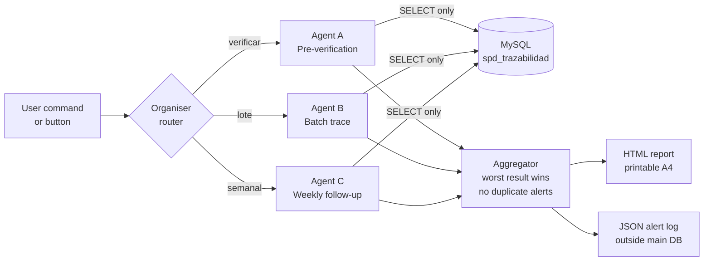

# SPD Traceability Agents · Read-only decision support for a pharmacy dosing service

**English** · [Español](README.es.md)

> SQL + Python agents that review a pharmacy's weekly medication blister packs **before a pharmacist signs them**, trace every dose back to its batch, and produce a one-page weekly to-do list.
> They **never write to the database and never decide**: they flag, explain and prioritise. The pharmacist decides and signs.

`MySQL` · `SQL` · `Python` · `pytest` · `YAML config` · `HTML reports` · `Data quality` · `Healthcare / GDPR-aware design`

---

## Why this project exists

I work as a pharmacy technician in Madrid, and I am moving into data analytics and BI. This project comes from a real process I was involved in: **rolling out an SPD service in my pharmacy**.

**SPD (Sistemas Personalizados de Dosificación)** is a service for patients who take many medicines. Every week the pharmacy takes the tablets out of their original packs and repacks them into a blister with one cell per day and dose time (morning, midday, night). It is regulated by the Standard Operating Procedure (PNT) of the Madrid College of Pharmacists (COFM, January 2023).

Running it by hand on paper showed me where the risks are:

- A blister must **never be valid for longer than any medicine inside it**, and medicines expiring in under 28 days are not suitable at all.
- Every dose must be **traceable to its batch and expiry date**. If a batch is recalled, you need to know *today* which patients have it at home.
- Prescriptions change, expire and need renewal. Patients forget to bring back used blisters. Missed doses are an adherence signal that is easy to lose.

These are checks a database can answer in seconds. A tired person at the end of a shift can miss them. So I modelled the service in MySQL and I am building small agents that ask those questions systematically.

> All patient data in this repository is **synthetic**. The design still treats it as real health data (GDPR): minimum data in reports, no personal data sent to any external service.

---

## What the agents do

| Agent | When the user runs it | Question it answers | Output |
|---|---|---|---|
| **A · Pre-verification** | Before the pharmacist checks a blister | *Is this blister safe to sign?* | Traffic light per blister + reason per medicine line |
| **B · Batch traceability** | When a batch recall arrives, or weekly | *Which patients have this batch, and where is it now?* | Affected patients grouped by status + data coverage % |
| **C · Weekly follow-up** | At the start of the preparation week | *Who do we need to call, renew or review?* | One printable page with three lists: **Call / Renew / Review** |
| **Organiser** | `todo` / "Run everything" | Runs A → B → C, merges results | Single report, most severe first |

### Architecture



The organiser contains **no clinical logic**. It routes the request, retries an agent once if it fails, ranks results and avoids repeating alerts that are still open. If an agent fails, its section says **"Agent not available"**. It never says "no issues".

### The decisions, rule by rule

Every rule is **one deterministic SQL query** in its own commented `.sql` file. Every result uses one of five codes:

`ROJO` (red: block) · `AMBAR` (amber: review) · `NO_COMPROBABLE` (cannot be checked) · `VERDE` (green: OK) · `LISTA` (work list)

**Agent A: pre-verification of a blister**

| # | Check | If it fails | Source |
|---|---|---|---|
| A1 | Patient has consent, is registered and not discharged on the preparation date | RED | PNT p.5, annex 2 |
| A2 | Every line has batch and expiry | CANNOT BE CHECKED | PNT p.11 |
| A3 | No medicine expires before the blister's validity date | RED | PNT p.21 |
| A4 | At least 28 days between preparation and expiry | AMBER | PNT p.19 |
| A5 | Validity ≤ 14 days | AMBER (needs written justification) | PNT p.12 |
| A6 | Preparer ≠ verifier | RED | PNT p.12 |
| A7 | There is a current prescription for that patient and medicine | RED | PNT p.21 |
| A8 | Dosage in the blister = dosage in the current prescription | AMBER | PNT p.19 |
| A9 | No unsuitable form (inhaler, injectable, patch…) inside the blister | RED | PNT p.8-9 |
| A10 | No incident left without a resolution | AMBER | PNT p.19 |

One red → the blister is red. Only ambers → amber. All green → green, **and the pharmacist still signs**.

**Agent B: batch recall**

It finds every blister line with that medicine code + batch and classifies the blister:
**in use** (red: retain/withdraw) · **already returned** (green: just record it) · **probably consumed** (amber: pharmacist's call). It also reports **data coverage**: if any line of that medicine has no batch recorded, the result is "incomplete (n lines)". A "0 patients affected" result is only accepted when coverage is 100%.

**Agent C: weekly follow-up**

Active patients only. Prescriptions ending within 7 / 14 days. Blisters not returned 2 / 7 days after expiry. Prescription changes after the last blister. Missed doses in 2 of the last 3 blisters. Adherence test older than 180 days or failed. Thresholds live in [`config/umbrales.yaml`](config/umbrales.yaml), and each one is labelled as coming from the PNT or as an internal decision.

---

## Design principles (and why)

1. **Read-only by construction.** The agents connect with a MySQL user that only has `SELECT`. The code also checks the grants at startup and refuses to run if the user can write. It then sets the session to `READ ONLY`. Safety does not depend on the code being bug-free.
2. **Propose, never decide.** The COFM consent form states *"there are no automated decisions"*. No agent signs, excludes a medicine, changes a dosage or contacts a patient. Every report is labelled *"Proposal, not a decision"*.
3. **"Cannot be checked" beats a false green.** If data needed for a rule is missing, the answer is `NO_COMPROBABLE`, never "OK". A report never says "no issues" without listing what it checked.
4. **Deterministic SQL, not AI, for the checks.** An LLM would only ever be used to write the report text from results that are already computed, and with no identifying data.
5. **Few, ranked alerts.** Most severe first, no duplicates of alerts still open. If everything is an alert, people stop looking.
6. **On demand only.** No cron, no background service. The user runs it, it reports and it exits.
7. **Traceable output.** Each alert shows the rule, the source table and field, the data date and the query version.
8. **Printable.** Pharmacy staff prefer paper. Reports are self-contained HTML that print on one A4 page, and they never rely on colour alone.

---

## Data model

Seven MySQL tables: `paciente` (patient), `medico` (doctor), `medicamento` (drug catalogue, with a `apto_spd` flag), `prescription`, `test_adherencia` (Morisky-Green result), `spd` (one blister per patient per week) and `spd_linea` (each medicine in each blister, with **batch, expiry, dosage snapshot, inclusion and incidents**).

Synthetic dataset: 16 patients, 27 drugs, 95 prescriptions, 125 weekly blisters, 729 blister lines. It includes deliberately seeded cases, such as 8 drugs whose only batch expires within 28 days of the November blisters.

Known schema gaps are documented, not hidden. Examples: dosage is stored as free text (`1-0-1`), consent is a yes/no flag with no date or signer, and there is no "unpacking date". When a gap affects a rule, the agent reports `NO_COMPROBABLE` instead of guessing.

---

## Project status

- [x] MySQL database designed, loaded and cleaned (empty values → `NULL`)
- [x] Project scaffold, read-only connection guard and tests
- [x] Thresholds in config with their source (PNT / internal)
- [ ] Real schema dump and test database with a seeded case for every rule branch
- [ ] Agent A · Pre-verification
- [ ] Agent B · Batch traceability
- [ ] Agent C · Weekly follow-up
- [ ] Organiser (routing, retry, ranking, de-duplication, archive)
- [ ] Optional local web page with four buttons (Streamlit/Flask)

## Run it

```powershell
py -m venv .venv
.\.venv\Scripts\python.exe -m pip install -r requirements.txt
# 1. As MySQL root, run sql/00_usuarios.sql (creates the SELECT-only user)
# 2. Copy .env.example to .env and fill in the password
.\.venv\Scripts\python.exe -m agentes conexion   # checks the read-only connection
.\.venv\Scripts\python.exe -m agentes esquema    # dumps the real schema to sql/01_schema.sql
.\.venv\Scripts\python.exe -m pytest -q
```

Planned commands: `verificar <id_spd>` · `verificar --fecha 2026-11-09` · `lote <cn> <batch>` · `semanal` · `todo`.

## Repository layout

```
agente.BD/
├── agentes/          # Python: comun.py (read-only connection, result codes), CLI, agents
├── sql/              # 00_usuarios.sql (DB users), 01_schema.sql, agentes/<A|B|C>/<rule>.sql
├── config/           # umbrales.yaml: thresholds + their source
├── tests/            # pytest, against a separate test database
└── informes/         # generated reports (git-ignored)
```

## What this project shows

- **Domain → data model:** turning a regulated healthcare procedure into tables, constraints and rules, with each rule traced to a page of the regulation.
- **SQL for data quality:** each business rule is a readable, commented query.
- **Responsible automation:** least-privilege access, explicit uncertainty (`NO_COMPROBABLE`), human-in-the-loop by design, GDPR-minded outputs.
- **Reporting for real users:** ranked, printable, one page, made for people who are busy.
